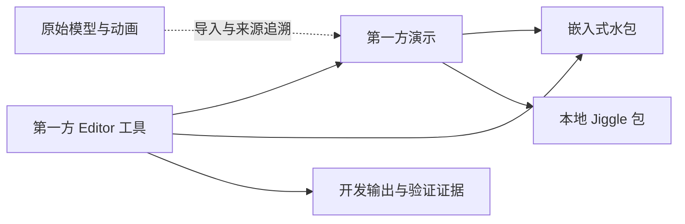

# TidePool 系统架构与边界

## 设计依据与效力

服务 [tidepool-goals](goal-and-requirements.md) 的数学研究目标。职责拆分及 Spec 优先规则已由用户确认；目录与调用说明来自源码核对。新建／修订节点保持 `draft`，用户整体审阅后才可转为 `active`。

每个事实只由一个节点拥有。`parent` 表示归属，`depends-on` 表示实际依赖，`references` 表示关联说明；历史设计原地采纳是路径保留的例外，不另复制同职责规范。

## 系统边界

- [tidepool-unity](TidePool/SPEC.md) 拥有 Unity 工程、依赖装配和导入边界；其内 [tidepool-game](TidePool/Assets/_Game/SPEC.md) 拥有第一方演示的场景绑定和模块间契约。
- [tidepool-sources](sources/SPEC.md) 拥有原始资源、来源与许可证；其中 Jiggle 是真实本地 UPM 依赖，不是下载缓存。
- [tidepool-water-package](TidePool/Packages/com.abstractocclusion.webgpuwater/SPEC.md) 拥有水模拟／渲染的包级边界；水位剧情不进入该包。
- `Development/`、备份、`work/`、根 `Temp/` 的历史记录不构成运行时模块。开发产物的保留规则见 [协作指南](CONTRIBUTING.md)。空的数据库 schema 也不构成已实现的数据模块。

## 不变量与变更顺序

- 设计、边界、契约和验收变化先向用户确认，再更新唯一所属 Spec，最后实施；无明确变更依据时不从代码倒推出批准。
- “设计要求”“当前实现”“历史证据”“尚未决定”明确分开。未实现研究要求不写成已交付，也不因实现欠缺就擅自取消。
- 核心数学与演示编排分离；算法不读取输入、不切场景、不修改玩家。Unity 适配层读取标定并提交结果。
- 同一骨架输出不得由多个驱动同时写入。不同显示／动画／附属动态的写入范围在所属 Spec 定义。
- 跨模块连接使用明确接口或序列化场景引用。添加玩法联动不是文档补全的隐含授权。
- 第三方源码、许可证、项目配置、资产与对应 `.meta` 是可迁移源，不以“可生成”为由批量忽略。生成缓存不能替代它们。

## 实际隔离与尚未决定

第一方 `Assets/_Game` 没有自定义 asmdef；上述边界是职责约定，不是已经由编译器强制隔离。水包和 Jiggle 有各自 Runtime／Editor 程序集。本次不移动代码或新增程序集。

世界位移驱动的长期选择明确暂缓，见 [tidepool-goals](goal-and-requirements.md)。玩家 Spec 中现有 CharacterController 路径只说明实现事实；不能由此推出“动画和头发没有位移”，也不能未经确认启用 Root Motion。

## 文档维护边界

[文档索引](docs/README.md) 负责导航与历史归类，[AGENTS.md](AGENTS.md) 负责代理执行规则，[CONTRIBUTING.md](CONTRIBUTING.md) 负责分支、提交、PR 正文和验证操作；它们链接 Spec，不复制各模块设计理由。
